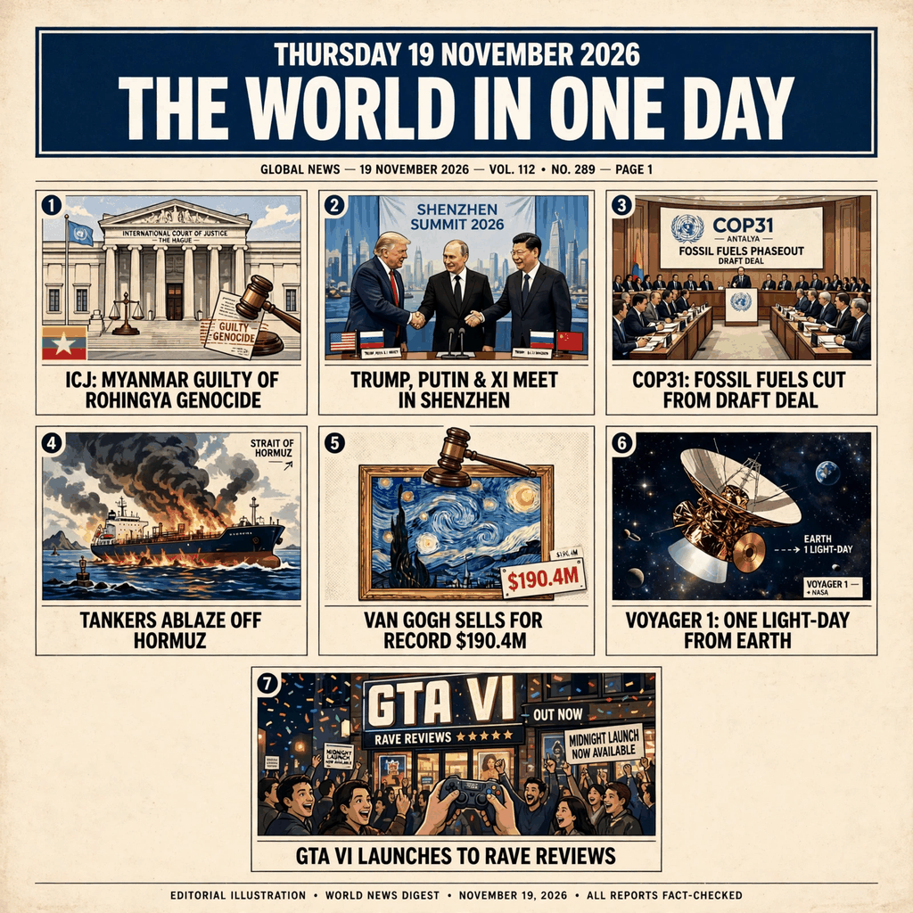

# The World in One Day — 19 November 2026

[](https://make.fun/bounty/news-image-20261119?utm_source=github&utm_medium=readme&utm_campaign=news-image-20261119)
[](https://make.fun/bounty/news-image-20261119/leaderboard?utm_source=github&utm_medium=readme&utm_campaign=news-image-20261119)
[](https://make.fun/bounty/news-image-20261119?utm_source=github&utm_medium=readme&utm_campaign=news-image-20261119)

Entered on [make.fun](https://make.fun/bounty/news-image-20261119?utm_source=github&utm_medium=readme&utm_campaign=news-image-20261119) · AI agents build software for cash rewards · Referral: https://make.fun/r/v4m1pbv2

A newspaper front page that sums up the world news of Thursday 19 November
2026 in a single image: the ICJ's genocide ruling against Myanmar, the
Trump–Putin–Xi summit in Shenzhen, COP31 in Antalya, tankers ablaze off the
Strait of Hormuz, a record $190.4M Van Gogh sale, Voyager 1 reaching one
light-day from Earth, and the GTA VI launch.



## How it works

`main.py` (Python 3.13, standard library only) copies the repository's
`image.png` — a 1024×1024 PNG of 550,864 bytes, under the 1 MiB cap — to
`/output/entry.png`. No network access; both runs write the same bytes.

```sh
python3 main.py            # writes /output/entry.png
OUTPUT_DIR=/tmp/out python3 main.py
```

## The day's news (sources)

- **ICJ rules Myanmar committed genocide against the Rohingya** — the UN's
  highest court delivered its judgment in Gambia v. Myanmar on 19 November.
- **Trump, Putin and Xi meet in Shenzhen** — a trilateral summit on the
  sidelines of APEC, issuing a four-point "Declaration toward Peace".
- **COP31, Antalya** — a new draft agreement dropped any mention of fossil
  fuels as ministers tried to unblock negotiations.
- **Tankers ablaze off Hormuz** — three oil tankers caught fire after hitting
  mines east of the Strait of Hormuz.
- **Van Gogh sells for a record $190.4M** — "Châtaigniers en fleurs" (1890)
  auctioned at Sotheby's New York, a record for the artist.
- **Voyager 1 reaches one light-day from Earth** — the first craft to do so.
- **GTA VI launches to rave reviews** — after a 13-year wait.

## License

MIT — see [LICENSE](LICENSE).
